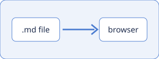
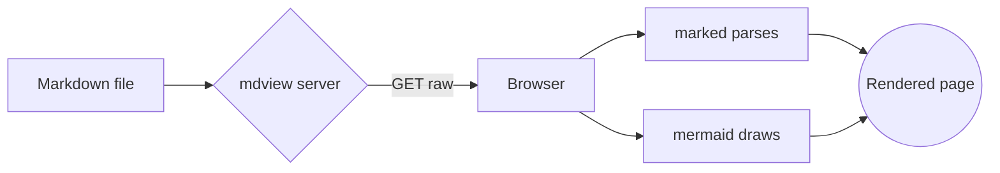
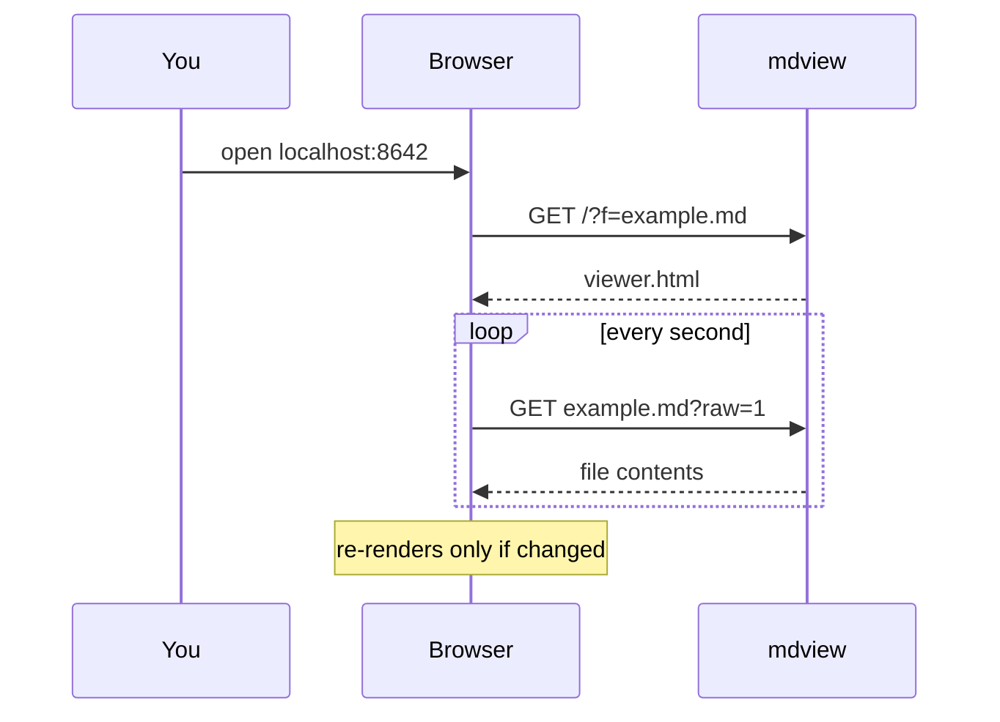
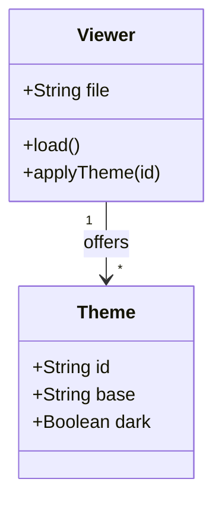
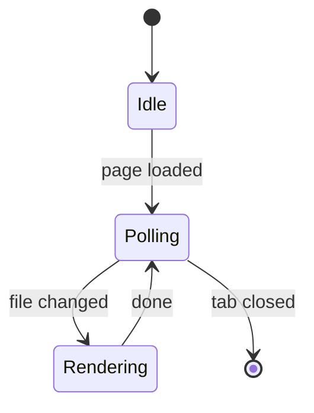
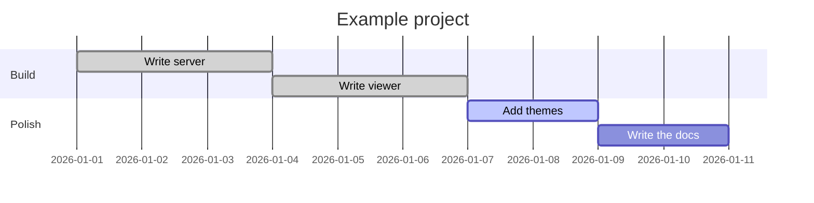
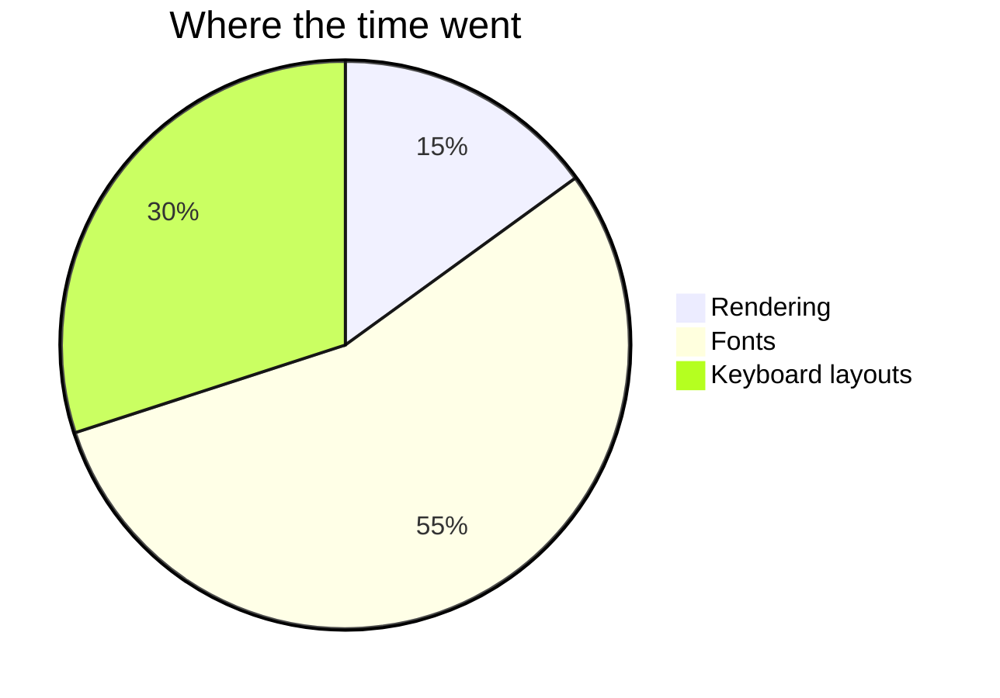

# mdview feature tour

This file exercises everything `mdview` renders. Open it with `mdview examples/example.md`, then try the **theme dropdown** in the top-right corner. Edit this file in another window and the page updates within a second.

---

## 1. Text formatting

Plain text, *italic*, **bold**, ***bold italic***, ~~strikethrough~~, and `inline code`.

A hard line break uses two trailing spaces:  
this line follows it. A new paragraph needs a blank line.

Escaped characters: \*not italic\*, \`not code\`, and a literal backslash \\.

Special characters render safely: 5 < 6, 7 > 3, fish & chips, "quotes", and 'apostrophes'.

Unicode and emoji pass through untouched: café, naïve, 日本語, Ελληνικά, ✅ ⚠️ 🚀.

## 2. Headings

# H1
## H2
### H3
#### H4
##### H5
###### H6

## 3. Lists

Unordered:

- Apples
- Oranges
  - Navel
  - Blood
    - Deeply nested
- Pears

Ordered:

1. First
2. Second
   1. Second-A
   2. Second-B
3. Third

Task list:

- [x] Render Markdown
- [x] Render Mermaid
- [ ] Take over the world

A list with paragraphs and code:

1. Install the dependencies:

   ```sh
   ./install.sh
   ```

2. Start the viewer:

   ```sh
   mdview examples/example.md
   ```

## 4. Links and images

- External link: [Mermaid documentation](https://mermaid.js.org/)
- Autolink: https://example.com
- Relative link to another Markdown file: [other.md](other.md)
- Link with a title: [hover me](https://example.com "A tooltip")

A relative image, resolved against this file's directory:



## 5. Blockquotes

> A single quote.
>
> > A nested quote.
>
> Back to the outer level, with **formatting** and `code`.

## 6. Code

Inline: use `mdview --no-open file.md` to skip the browser.

Fenced, with a language label:

```python
def fib(n: int) -> int:
    """Return the nth Fibonacci number."""
    a, b = 0, 1
    for _ in range(n):
        a, b = b, a + b
    return a

print([fib(i) for i in range(10)])
```

```javascript
const greet = (name) => `Hello, ${name}!`;
console.log(greet("world"));
```

```json
{ "name": "mdview", "private": true }
```

Indented code block (four spaces):

    no fence needed
    just indentation

Code containing HTML is escaped, not interpreted:

```html
<script>alert("this is shown as text")</script>
```

## 7. Tables

Column alignment is controlled by the colons in the separator row.

| Left aligned | Centered | Right aligned |
|:-------------|:--------:|--------------:|
| apple        |   red    |          1.25 |
| banana       |  yellow  |          0.50 |
| cherry       |   dark   |         12.00 |

Tables can hold inline formatting:

| Feature | Supported | Notes |
|---|---|---|
| **Bold** and *italic* | ✅ | works in cells |
| `code` | ✅ | monospace |
| [links](other.md) | ✅ | relative links too |

## 8. Horizontal rules

Three styles, all the same result:

---

***

___

## 9. Raw HTML

Some inline HTML is allowed: <kbd>Ctrl</kbd> + <kbd>S</kbd>, H<sub>2</sub>O, x<sup>2</sup>, and <mark>highlighted</mark> text.

<details>
<summary>Click to expand a collapsible section</summary>

Hidden content, with **Markdown** inside it.

- one
- two

</details>

## 10. Mermaid diagrams

Diagrams re-theme automatically when you change the dropdown.

### Flowchart



### Sequence diagram



### Class diagram



### State diagram



### Gantt chart



### Pie chart



## 11. What is not supported

- Math (`$x^2$` or LaTeX) is not rendered.
- Footnotes are not rendered.
- Code blocks have no syntax highlighting; the language label is parsed but not coloured.
- Only Mermaid is drawn from code fences; other diagram languages are shown as plain code.

---

*End of tour. Try switching to **Solarized Dark** or **Sepia** from the dropdown.*
